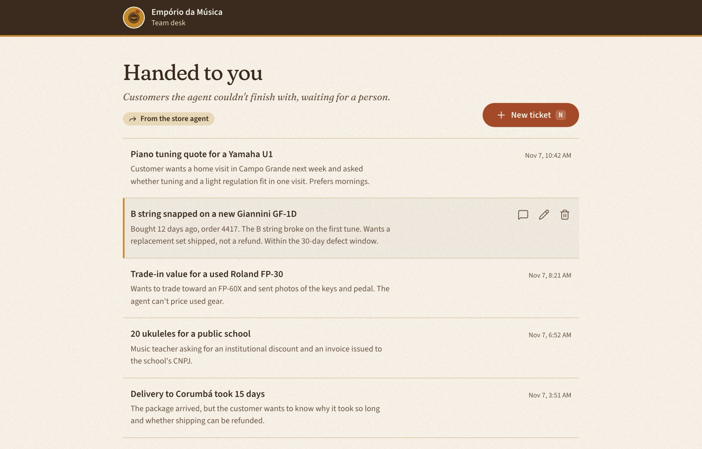
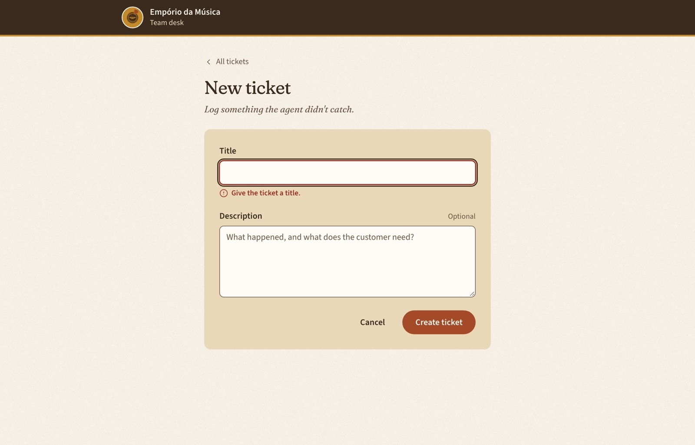

# Empório Tickets

The ticket board of Empório da Música's support team. When the store's AI agent can't finish with a customer (a piano tuning quote, a defective string set), it hands a ticket to a person. This board lists those tickets, preloaded on the server, and lets the team create, edit and delete them.

Built with **Next.js 15 (App Router)**, **tRPC v11** and **TanStack Query**, over an **in-memory** store, in the Empório design system.



## Run it

Requirements: Node 22+ and pnpm.

```bash
pnpm i
pnpm dev            # http://localhost:3000
```

| Command | What it does |
|---|---|
| `pnpm test` | Unit and integration tests (Vitest, about 100 tests) |
| `pnpm test:e2e` | Browser tests (Playwright) against a production build on port 3100. Run `pnpm exec playwright install chromium` once first. |
| `pnpm check` | Route types, lint, typecheck and tests: the gate before every commit |
| `pnpm build && pnpm start` | Production build |

The store starts with 25 sample tickets and resets on every restart.

## What the brief asked, and where it is

| Brief | Here |
|---|---|
| Task with `id`, `titulo`, `descricao?`, `dataCriacao` | `Ticket { id, title, description?, createdAt }`: `id` is a UUID, `createdAt` an epoch-millisecond timestamp |
| CRUD over tRPC | `ticket.list`, `ticket.byId`, `ticket.create`, `ticket.update`, `ticket.delete` in [`src/server/tickets/router.ts`](src/server/tickets/router.ts) |
| No ticket without a title; clear errors | Zod (`title` trimmed, 1 to 120 chars) on client and server; an unknown id answers 404 "Ticket not found." |
| List preloaded with SSR; delete with feedback | The board awaits the first page on the server and hydrates it; delete asks first, then a toast confirms or explains |
| Create/edit form with hooks; block empty titles | One form for both, React Hook Form with the same Zod schema |
| Loading, success and error states | Skeleton rows, toasts, field errors, an alert banner, retry on a failed page, error and 404 pages |
| Bonus: infinite scroll | Keyset cursors, a real Load more button that is also the scroll trigger |
| Bonus: comments and README | This file, comments on the non-obvious parts, and [decision records](docs/decisions) |



## How it works

```
src/
  domain/tickets/    pure rules: Zod schemas, limits, keyset pagination, error codes
  shared/            Result<T, E>
  server/            the backend: in-memory store, tRPC router, HTTP handler (server-only)
  trpc/              tRPC glue for the browser (client.tsx) and server components (server.tsx)
  client/tickets/    UI by use case: list, form; each component pairs with a use{Name} view model
  client/shared/     design system, the one function that turns errors into copy
  app/               routes only
  test-support/      factories and render helpers for tests
```

**A request, end to end**

1. `GET /` runs a server component that awaits `ticket.list` in-process and renders the first 10 tickets into the HTML.
2. The browser hydrates that page from the dehydrated cache, so it doesn't fetch the first page again.
3. Scrolling near the end loads the next page through `/api/trpc` (batched GET). Delete and save are POST mutations.
4. Deleting removes the row from every cached page without refetching. Saving drops the cached list and goes back to a fresh server-rendered board.

**Pagination.** Newest first (`createdAt`, then `id` as tie-breaker), keyset cursors (`base64url` of `{ v, t, id }`), `limit + 1` to know if another page exists. Every ticket that exists for the whole scroll appears exactly once; new tickets show up on the next refresh; deleted ones never come back. A malformed cursor is a 400, never a silent restart.

**Errors.** The store returns `Result` values with domain codes; one exhaustive map turns them into tRPC errors (404, 403, 400); unexpected errors are masked in production; the client decides copy by code in one place.

**Components.** A use-case component calls one hook, its view model, and only renders. View models are tested against the real router through tRPC's `localLink`; components are tested with their view model mocked.

## Decisions

| | |
|---|---|
| [0001](docs/decisions/0001-trpc-tanstack-integration.md) | tRPC through the TanStack React Query integration (the classic one is bug-fix only) |
| [0002](docs/decisions/0002-in-memory-store.md) | In-memory store on `globalThis`, injected through the tRPC context |
| [0003](docs/decisions/0003-keyset-pagination.md) | Keyset pagination with opaque cursors |
| [0004](docs/decisions/0004-ssr-prefetch-hydration.md) | SSR through an awaited prefetch and hydration |
| [0005](docs/decisions/0005-view-models-and-forms.md) | View-model pattern; React Hook Form over the shared schema |
| [0006](docs/decisions/0006-next-15-and-no-superjson.md) | Next.js 15.5 (as the brief names), epoch timestamps, no superjson |
| [0007](docs/decisions/0007-domain-oriented-folders.md) | Domain-oriented folders and enforced import rules |
| [0008](docs/decisions/0008-security-posture.md) | Security: what is mitigated, how it is proven, what is skipped |
| [0009](docs/decisions/0009-error-handling.md) | Error handling: Result values, domain codes, one message function |

The design, the research behind each choice (with sources) and the implementation plan are in [`docs/`](docs).

## Testing

| Layer | What it proves |
|---|---|
| Domain | Schema rules; pagination on examples and a property test (fast-check, fixed seed) over up to 1,000 tickets with creates and deletes between pages |
| Store and router | Result values, the error map, every procedure's contract, the 1,000-ticket cap |
| HTTP | Status codes, the batch limit, form-encoded and `text/plain` mutations rejected, no stack in production |
| View models and components | Infinite scroll guards, delete and save flows, double clicks, error copy, every rendered state |
| End to end | The list is in the HTML with JavaScript off; no duplicate first-page fetch; create, edit, delete; 404s; security headers; long titles wrap |

## Performance and security

`next build` (First Load JS): `/` 199 kB, `/tickets/new` 191 kB, `/tickets/[id]/edit` 196 kB, shared 103 kB.

Lighthouse on `pnpm start`:

| | Performance | Accessibility | Best practices | LCP | TBT | CLS |
|---|---|---|---|---|---|---|
| Desktop | 100 | 100 | 100 | 0.8 s | 20 ms | 0 |
| Mobile (throttled) | 75 | 100 | 100 | 4.4 s | 420 ms | 0 |

Mobile LCP is mostly web fonts on a throttled connection. The paper texture is a pre-rendered tile: as an SVG filter it cost 4 seconds of blocking time.

Security headers (`nosniff`, a strict referrer policy, `frame-ancestors 'none'`), no `X-Powered-By`, a cap on stored tickets and on batch size, and a blocking `pnpm audit` in CI. Details in [0008](docs/decisions/0008-security-posture.md).

## Limitations

- Data lives in one server process: it resets on restart and isn't shared across instances, so this isn't deployed to serverless.
- No authentication or users.
- A nonce-based `script-src` CSP needs middleware and dynamic rendering everywhere; it is the production step.
- Up to 1,000 rows render without virtualization; past that, `content-visibility: auto` on rows, then a virtual list.
- Upgrading to Next.js 16 is mostly a version bump: params are already awaited and there is no middleware.

## Next steps

- A database behind `src/server/tickets/store.ts` and authentication.
- Deploy once state is shared.
- Live handoff: designed, not built yet. Unlocks right after this candidate gets hired.

## Design

The Empório da Música design system: tokens, type, components and voice. Fonts are self-hosted through `next/font` (Fraunces and Source Sans 3).
